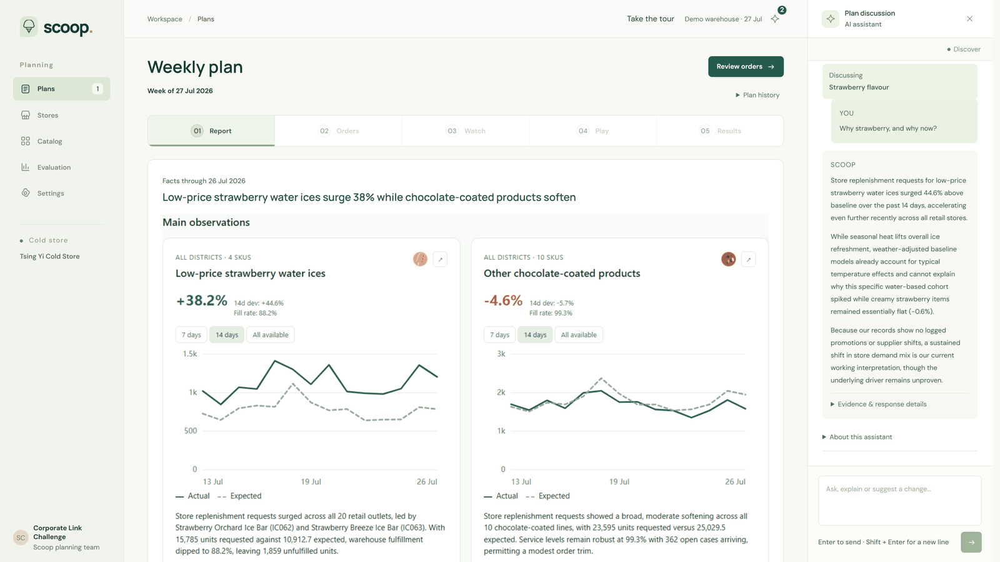

# AI assistant

Scoop's assistant uses Gemini 3.8 Flash for language: explaining, answering and taking instructions. All forecasts, trends and order quantities come from the planning engine.



## What it does

- Writes the weekly report from the computed findings.
- Answers questions about the report and looks up data.
- Turns the planner's context into adjustments to the engine, such as an end date for a trend.
- Makes edits the planner asks for: bulk order changes and dashboard widgets.

## How it stays reliable

The assistant works only through bounded, read-only query tools and the same API as the web app. Every number in the report must match the data it cites; if not, the app falls back to the computed findings. Charts are drawn by the app from saved data, not by the model. Every change the assistant makes shows a before/after receipt and can be undone. Orders are placed only when the planner approves them.

## Setup

Without an API key, the app runs on the computed findings and a scripted assistant handles basic commands. For the live assistant:

```sh
SCOOP_LLM_PROVIDER=gemini     # in .env
GEMINI_API_KEY=...            # in the server environment only
```

The key never reaches the browser. The defaults cap use at 50 calls a day (`SCOOP_LLM_DAILY_MAX_CALLS`) and 120 calls or about US$3 in total.
