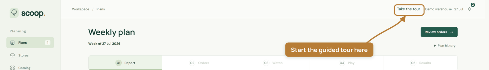
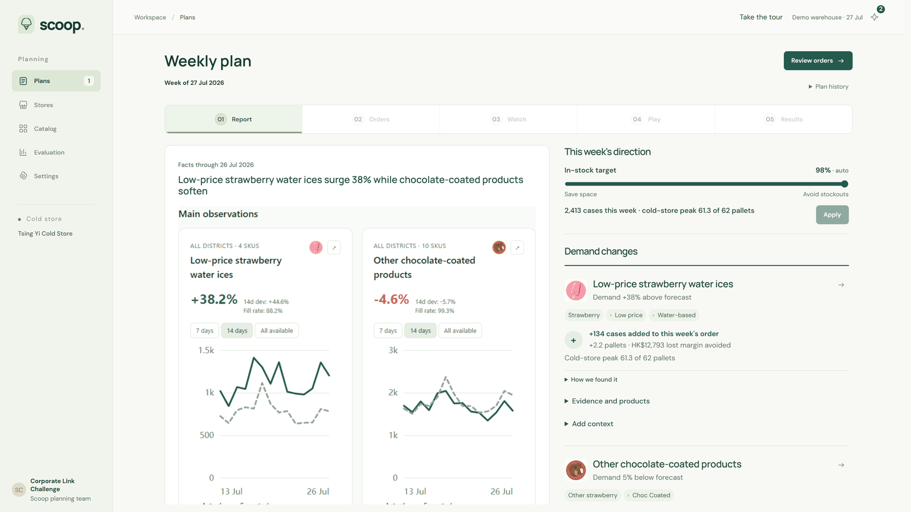
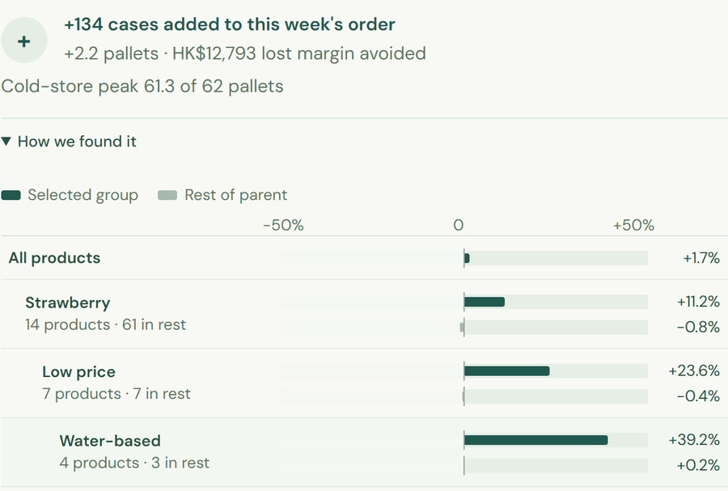
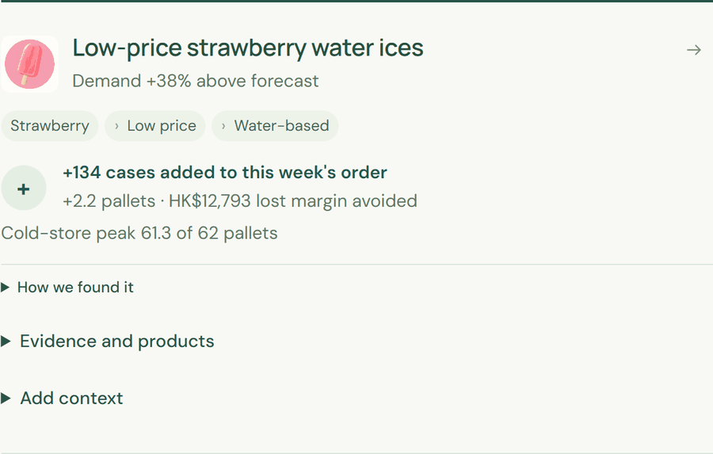
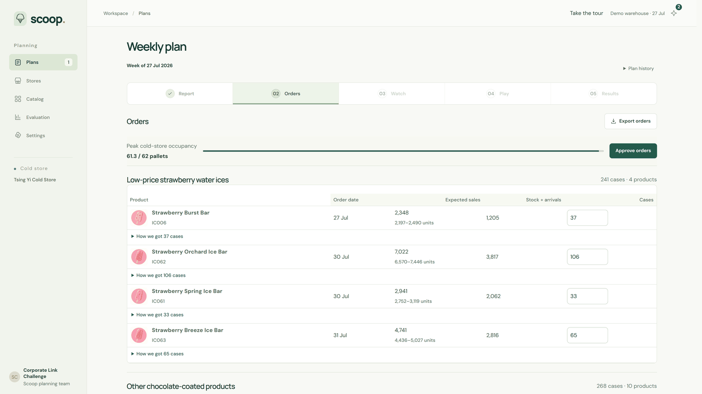
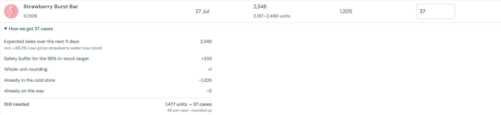
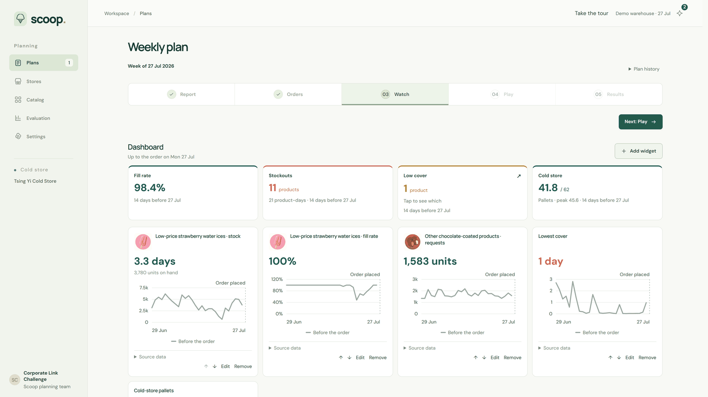
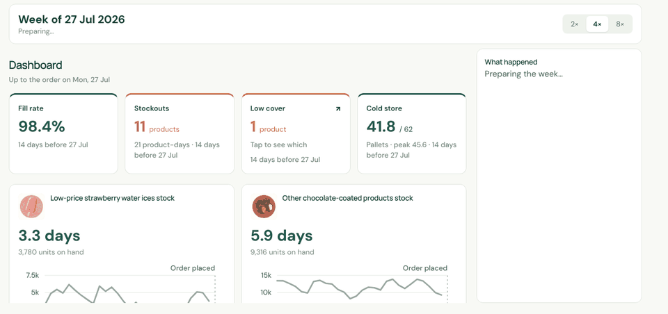
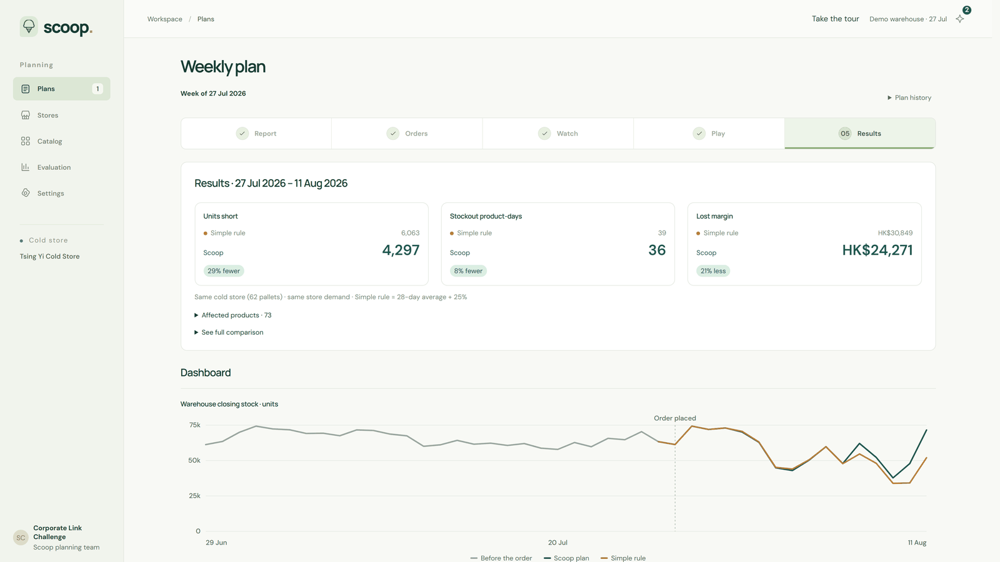

# Demo guide

The demo runs at [scoopplanner.com](https://scoopplanner.com). It opens on Monday 27 July 2026 in a synthetic cold store with 62 pallets of space, 75 ice-cream products and 20 stores. One trend is planted in the data: low-price strawberry water ices are rising. The steps below show how Scoop finds it and turns it into an order.

## Start

Click **Take the tour** at the top right for a guided walk through every step. To use the app freely instead, just start from the Report.

## 1. Report

The weekly report says what changed in demand and why. Here it leads with low-price strawberry water ices, up 38% on forecast, while chocolate-coated products soften.

Open **How we found it** on a finding to see where it comes from. The change is small across all products and grows as the group narrows to strawberry, then low price, then water-based.

Use **Add context** to tell Scoop what the data cannot know, such as that the trend is a one-off. The order is recalculated at once.

## 2. Orders

Every product has a recommended order. The bar at the top shows the peak cold-store space. Change any line by hand, then **Approve orders**.

Open **How we got … cases** on any line to see its calculation.

## 3. Watch

The dashboard shows fill rate, stockouts, low cover and cold-store space, with widgets for the products you choose. **Add widget** builds your own view.

## 4. Play (demo only)

Play runs the next two weeks forward so you can see stock arrive, sell and sometimes run out. Choose 2×, 4× or 8×.

## 5. Results (demo only)

Results compares Scoop's order with a simple rule (the last 28 days' average plus 25%), with the same stores, demand and cold store.

## Reset

**Settings → Reset** returns to the start of the week. Settings also offers a quieter week (22 June) with no planted trend.
