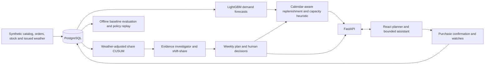

# Scoop: system design and technical document

**Corporate Link Challenge 2026 - working prototype**

| Project record | Value |
|---|---|
| Repository | [Hcrab/scoop-clc2026](https://github.com/Hcrab/scoop-clc2026) |
| Branch | `claude/scoop-prototype` |
| Data | Deterministic synthetic ice-cream distribution world, seed 42 |
| Team | ID, roster and individual contributions to be confirmed by the team before submission |

This document follows the subject coverage of the local CLC2026 shortlisting technical-document example and rules v1.6 (2 October 2026). It is a development document, not a declaration that all submission conditions have been met. In particular, repository publication and team declarations remain owner decisions.

## 1. Problem and proposed solution

Cold storage is scarce. A warehouse planner has to replenish familiar products while distinguishing weather-driven demand from persistent changes in preference. A sales increase can also be a promotion, a single large order or a shift in the mix of stores. Treating each increase as permanent can tie up space; ignoring it can cause shortages.

Scoop connects a weekly evidence review to concrete case quantities. The planner sees attribute-level signals, checks explanations, records a purchasing direction, then receives recommendations constrained by supplier calendars, case packs, stock, pipeline and warehouse capacity. A persistent assistant explains the evidence and performs bounded, auditable actions. The core output is a reviewed replenishment plan and watch list.

The prototype represents one DC, 20 stores, four districts, eight suppliers and 60 existing SKUs. All product, customer, order and weather records are synthetic. Its commercial hypotheses require validation on authorised operational data.

## 2. Architecture and data flow

The generation command creates relational source tables. Model runs use time-bounded features; reusable artifacts are cached locally and excluded from version control. Planning combines detector evidence and inventory forecasts, then persists findings, hypotheses, questions, directions and purchase suggestions. The HTTP API returns joined, typed JSON to the UI. Mutations persist choices and decision records. Offline evaluation reads the same source data with explicit training, calibration and replay intervals.

## 3. Data model

| Layer | Main entities | Purpose |
|---|---|---|
| Reference data | Store, Node, Supplier, Product, Nutrition, TagDimension, Tag, ProductTag | Locations, warehouse capacity, calendars, case packs and comparable attributes |
| Daily facts | StoreOrder, NodeInventory, WeatherDaily, WeatherForecast, Promotion, PurchaseOrder | Demand versus fulfilment, stock, information vintages and known commercial events |
| Analytical output | ModelRun, DailyExpectation, CusumSeries | Forecast lineage and signal evidence |
| Decision workflow | Plan, Finding, Hypothesis, Question, Decision, DirectionItem, PurchaseSuggestion, WatchItem, ChatMessage | Human interpretation, recommendations, approvals and context |
| Evaluation only | GroundTruthEvent | Planted scenarios for scoring; not investigator inputs |

The generated world spans June 2024 to August 2026 and contains 986,400 store-SKU-day rows. The seed fixture defaults to 13 July 2026; the delivered workspace also contains a completed 20 July walkthrough and a fresh 27 July plan. The visible demonstration clock is the authoritative as-of date. Reading future rows is permitted only in the offline scorer, never as future actual inputs to a current planning recommendation.

## 4. Technical approach

### Demand and uncertainty

LightGBM models use product/store attributes, calendar features, promotion information and weather available at forecast time. Replenishment needs a demand distribution over a SKU-specific protection interval, not simply a next-day point forecast. The protection interval includes waiting until the ordering weekday, supplier lead time and review interval. Aggregate uncertainty is empirically calibrated; see `docs/ALGORITHM_NOTES.md` for the exact implemented windows and approximations.

### Preference monitoring

The detector compares observed attribute share with expected share after conditioning on ordinary drivers. A model frozen within each month avoids immediately absorbing a gradual preference change. Detection and procurement share that monthly version; training ends before the month starts, and CUSUM resets at the boundary. The preceding version’s forward errors calibrate the next version, a transfer approximation whose weak coverage is reported below. Saved findings retain their original chart version, including legacy fixed-baseline plans. CUSUM accumulates departures; bootstrap calibration and multiple-testing rules limit alerts. A statistically interesting group can still reflect promotion, weather or store mix. Shift-share separates descriptive volume, mix and interaction terms.

### Evidence and human judgement

The investigator uses scoped database evidence to rank explanations. Users can classify a finding as persistent, one-off, a data issue, weather-related or uncertain. That judgement changes the direction of relevant purchasing decisions. Persistent and weak evidence are handled differently: an uncertain signal can remain on a watch list without becoming an automatic inventory increase.

### Purchasing

The order-up-to calculation subtracts current stock and pipeline, rounds positive orders to full cases and applies SKU minimum quantities. The chosen margin, fill-rate or sales objective affects recommendation logic. Warehouse space is allocated with a conservative greedy heuristic and SKU-specific pallet footprints. The implementation does not claim global optimality or a guarantee that a requested service parameter equals the observed fill rate.

### Application and assistant

The UI provides Plans, Stores, Catalog and evaluation views. The weekly flow is Discover, Direction, then Execute & watch. A fixed right-hand chat area keeps context visible. FastAPI validates mutations and phase transitions; order confirmation is synthetic and idempotent. The built frontend can be served by the API for a single-origin local demo.

The local delivery uses Gemini 3.8 Flash when an existing backend GEMINI_API_KEY is available. It receives bounded synthetic plan context and can call only validated domain tools for evidence, scenarios and explicitly requested edits. Questions and hypotheticals remain read-only; stage approval and purchase confirmation stay in the UI. Actual operation progress is streamed, and a final result appears only after the transaction commits. A bounded SQLite usage ledger enforces call/cost allowances without recording credentials. An explicitly labelled deterministic fallback remains available when the provider is absent or unavailable. The repository default needs no key. See docs/ASSISTANT.md for configuration, boundaries and failure behaviour.

Five baseline watches, decision-derived watches and user additions are reviewed before execution. Approval freezes the selected watch assumptions and occupancy projection. Later watch edits remain separate from that approval; the following week carries assumptions forward and displays a past-only recap. Warehouse stock remains shared, so district shortage watches use order fulfilment rather than inventing district stock allocations.

## 5. Setup, test and demonstration

See `README.md` for the exact installation and run commands and `docs/DEMO.md` for a guided demonstration. Reproducibility requires PostgreSQL, the pinned Python environment, and the frontend lockfile. Synthetic loading replaces tables in the configured database and is a first-run/reset operation, not a normal startup step.

The demo supports weekly plans from June through August 2026. Inspect the weekly report, open a finding's chart and explanation, answer the interpretation questions, approve directions and the objective, inspect the case-level order rationale, confirm one synthetic order, and add a scoped watch. Reload the page to verify persisted decisions. Stores and Catalog provide traceable source context.

## 6. Validation and limitations

The evaluation includes forecast errors against simple baselines, planted-event detection delay, null-world alert behaviour, explanation labels and an inventory replay. Results are generated in `reports/`, with the precise interpretation in `docs/ALGORITHM_NOTES.md`. Missing detections and unfavourable service/inventory trade-offs remain in the report.

The no-trend counterfactual keeps the same catalog, weather and known promotions while removing preference drift, exceptional promotion uplift and bulk orders. It is reproducible for a seed, but changed Poisson intensities mean draws do not remain exactly paired after the first change; it is a detector diagnostic, not a causal estimator.

The monthly seed-42 run reports these outcomes:

| Measure | Scoop | Comparison / context |
|---|---|---|
| Daily demand WAPE, April-May | 49.48% | 28-day average: 52.50%; same weekday: 70.72% |
| Rolling protection WAPE, April-August | 10.85% | 28-day average: 10.04% |
| Protection interval coverage | 64.49% | 780 forward windows; nominal 80% |
| BH-gated missed targets | 1 of 11 | 1/7 strong and 0/4 weak; 9 detections more than 14 days late |
| Null-world alarm episodes | 0 after BH gate | 547 raw episodes; one synthetic diagnostic |
| Full policy at 96% protection quantile | 98.58% fill; 29.0 average pallets | Historical x1.25: 98.72% fill; 32.0 pallets |
| Fixed reorder-point baseline | 79.06% fill; 16.0 average pallets | Frozen May mean; no adaptation to later demand |

The full policy uses less average inventory but provides slightly lower service than the historical x1.25 policy; its pre-shipment peak is also higher (58.2 versus 57.4 pallets). This is a trade-off, not a universal win. Forecast aggregation performs worse than the moving-average protection baseline, and interval undercoverage is material, especially in July. Investigator labels agree with 8 of 12 matched findings; four unmatched findings are retained. Exploratory weak candidates have 18 confirmations in 36 complete followups, with eight right-censored candidates; the different-scope random comparator is not a formal superiority test.

A real Gemini walkthrough on the separate 20 July plan explained the focused Water-based finding, recorded an explicit persistent interpretation and calculated a read-only 35°C scenario. With that plan state, a July 27-August 2 override changes proposed cases from 1,025 to 1,246 (+221); numbers depend on the current plan decisions. Live model prose initially overstated causal certainty and exposed unnecessary technical wording, so the assistant brief was tightened. Provider answers still require human review; successful tool validation does not prove every generated sentence is correct.

The central test run passed 68 Python tests and the TypeScript/Vite production build. Tests include monthly cutoffs and reset state, future-data perturbation, persisted choices, provider outage handling, budget limits, historical chart provenance, streamed transaction rollback and watch approval/carryover. Existing 6 July and 13 July plans were preserved, and a separate 20 July plan completed the new browser walkthrough. Its 26-case confirmation and scoped watch carry into the 27 July recap and fresh Discover plan. Responsive checks at 390, 768 and 1280 requested viewport widths found no horizontal overflow; the watch editor also passed keyboard focus and Escape checks.

Application validation covers phase guards, persisted choices, invalid input, idempotent confirmations and as-of views. Frontend compilation and a browser walkthrough provide separate evidence of the usable interaction. A successful build alone is not treated as proof that every flow works.

Important limits are synthetic realism, monthly reset detection delays, transferred calibration undercoverage, heuristic capacity allocation, fallible live-model prose, no real supplier integration and no automatic stock simulation following user confirmations. Deployment authentication, tenancy and production operations are outside this local demonstration.

## 7. AI, data and third-party disclosure

Claude materially contributed the original product discussion, architecture, synthetic data generator and analytical implementation. OpenAI Codex recovered the interrupted work, completed the local application and assisted with review, corrections, verification and documentation. Human team members must review the implementation and supply their own accurate contribution statements. A tool-generated document cannot attest to human contributions.

The runtime data is generated by `scoop.synth.generate`; no sponsor transaction dataset is included. Product names and tags are fixtures. See `docs/THIRD_PARTY.md` for dependencies and installed licence metadata. No external weather API is used. The repository default uses the offline assistant; the delivered local session is configured for the explicitly requested Gemini trial, transmitting synthetic plan context only.

## 8. Team and submission readiness

The team must supply its confirmed Team ID, team name, roster, role and specific contribution for each registered member. It must also review AI disclosures, applicable licences and the release contents. The current private branch is not yet the publicly accessible repository required by the competition's shortlisting submission rules.

Before submission, export a reviewed presentation of at most 20 PDF pages and this technical document in PDF, using the competition's Team-ID filename pattern. Verify links and confirm that the publicly accessible release is the intended submitted version. These are publication steps for the owner; this prototype build does not submit anything to the organisers.
