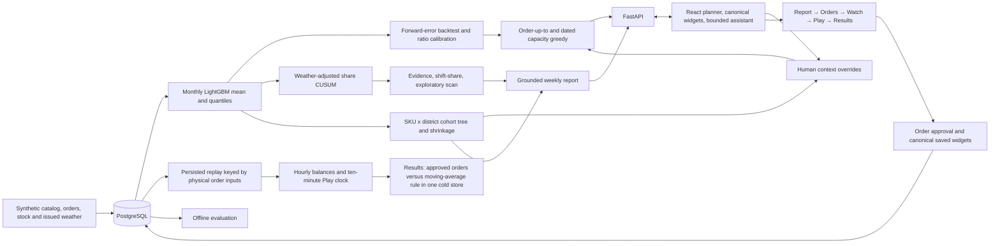

# Scoop: system design and technical document

**Corporate Link Challenge 2026 - working prototype**

| Project record | Value |
|---|---|
| Repository | [Hcrab/scoop-clc2026](https://github.com/Hcrab/scoop-clc2026) |
| Branch | `claude/scoop-prototype` |
| Data | Deterministic synthetic ice-cream distribution world; public demo seed 93, 27 July 2026 |
| Team | ID, roster and individual contributions to be confirmed by the team before submission |

This development document describes the implemented system and its measured results. Team identifiers and individual contribution declarations remain for the team to complete.

## 1. Problem and proposed solution

Cold storage is scarce. A warehouse planner has to replenish familiar products while distinguishing weather-driven demand from persistent changes in preference. A replenishment-request increase can also be a promotion, a single large order or a shift in the mix of stores. Treating each increase as permanent can tie up space; ignoring it can cause shortages.

Scoop connects a weekly evidence review to concrete case quantities. Cohort effects feed recommendations constrained by supplier calendars, case packs, stock, pipeline and warehouse capacity. The planner supplies optional context and reviews the resulting orders. An assistant explains evidence and makes explicitly requested, undoable changes. The five-screen flow carries the reviewed plan through monitoring, timed replay and measured results.

The default prototype represents one DC, 20 stores, four districts and 75 SKUs. All product, customer, order and weather records are synthetic. Its commercial hypotheses require validation on authorised operational data. Other seeds remain internal evaluation fixtures.

## 2. Architecture and data flow

The generation command creates relational source tables. Model runs use time-bounded features; reusable artifacts are cached locally and excluded from version control. Planning persists cohort effects/cards, early warnings and purchase suggestions. Overrides and dashboard layout are saved alongside decision receipts; the historical ORM table named WatchItem stores the canonical widgets. The report reads calculations and can explore evidence; its text does not directly control orders. Approval queues a replay that stores per-product series for both policies; its key uses effective physical inputs, so widget edits do not recompute it. The HTTP API returns typed JSON to the UI. Offline evaluation uses explicit training, calibration and replay intervals. Fast Reset restores persisted initial planning templates for an already prepared week, clearing edits, context, chat, replay and progression without rebuilding source data or model fits or calling Gemini. A first unprepared week still needs preparation; replacing the full synthetic world is a separate operation.

### 2.1. Isolated guided tour

`TourHost` wraps the same `App`; `GuidedTour` supplies the spotlight, verbatim copy table, choices, recorded-answer typing and native edit receipts. Tour entry creates an in-memory session before the app mounts. `api.ts` then routes every app request to `tour/runtime.ts`, which returns cloned recorded API responses and handles local flow, context and widget selection. Unsupported requests throw; they cannot fall through to HTTP. Explore continues to use the ordinary transport. Exit discards the session and remounts Explore at the default Report without a database reset. The welcome does not mount the live planner underneath it, so entering a tour cannot trigger its normal preview POST.

`scripts/build-tour-bundle.py` copies immutable source and saved clean default-week records into an independent PostgreSQL schema with independent sequences. It excludes `ground_truth_events`, routes database consumers to that schema, resets via the real API and records exact report, drilldown, cohort, preview, order, dashboard and complete simulation responses. Every context branch is genuinely recomputed and replayed. Widgets are added and undone through the real API on each branch. Provider access is disabled throughout this build; every public table is fingerprinted before and after.

The summer choice is an `ends_on` override for 10 Aug. The growing choice is an `expect` override at the existing 80% interval's upper endpoint, with high confidence; it is a fixed optimistic user-context choice, with no threshold or outcome tuning. Unchanged applies no override. Their strawberry order totals are 209, 246 and 241 cases; full-plan totals are 2,381, 2,418 and 2,413. Their stored orders, per-product replay and aggregate outcomes are distinct. Question and widget choices affect display only.

`scripts/record-tour-answers.py` separately reuses the isolated schema and calls the normal `/chat` assistant path with Gemini 3.8 Flash for two questions and three context choices. It checks physical order identity, applies the existing numeric grounding checker to actual snapshot/tool evidence, and stores the reply, model/provider, usage, tool trace, claims/evidence and snapshot hash. Answers are limited to three sentences, with at most one retry per recording attempt. In the browser these are explicitly labelled **Recorded example** and type at about 40 characters per frame; no provider call is made. The context receipt uses the real saved override result and updated quantities. V2 displays the optional question recordings; the three recorded context replies remain in the bundle, while the context step now shows the four recalculation beats.

The version-2 bundle carries the pristine default-week production order hash. `/api/tour/source` runs a read-only database transaction and reuses `simulation_jobs.order_hash` with saved plan/orders/context substituted in memory and current physical inputs read normally. It neither updates live records nor locks live orders. A changed default fingerprint fails entry and the stale-bundle tests. Rebuild with `python scripts/build-tour-bundle.py`, then `python scripts/record-tour-answers.py` with Gemini configured, and `pnpm --dir frontend build`. A freshly built bundle without the separate recording step is incomplete and must not be published as a completed tour.

The fourteen-step desktop tour (plus unnumbered welcome/end) fixes the document height and scrolls its panels locally. Inline **bold** is rendered as strong text from the verbatim copy table. The report finding is located through a source/channel-validated postMessage bridge; the opaque iframe retains sandbox="allow-scripts". Only the target and coach accept interaction; sliders, inline quantity edits, free chat and widget editing are unavailable. Play defaults to 2× (2,000 ms/day), with 4× (1,000 ms/day) and 8× (500 ms/day) in both Explore and tour. A speed change reanchors at the displayed ten-minute tick; the shared replay cursor drives widgets, health tiles, events and coach captions. The tour has no pause control. Coach copy is filled from actual branch values. Keyboard and narrow-screen behavior are tested in `frontend/e2e/tour.spec.ts`; three complete branch runs compare rendered copy, screenshot every step, check coach geometry, Play document height, zero HTTP non-GET requests, unchanged provider usage and unchanged hashes of every public table.

Version-2 metadata is derived from the genuine recorded snapshots: cohort `f50` is the expected-recent-demand-weighted mean across the four strawberry SKUs; case totals sum their effective orders; peaks use planning `projected_peak_pallets`, not physical replay peaks. Additional capacity cuts compare per-SKU `capacity_cut_cases` with the clean base and retain product-level deltas. Step 7 holds context, factor, cases and peak for 1.5 seconds each, interpolating only their display; Next appears after all beats. Nothing to add has one beat. No new cuts occur in the bundled growing branch, so its explicitly optional trimming sentence is omitted. Actual `WeatherDaily.tmax` on 30 July is 33.6°C and is replay metadata only. `python scripts/enrich-tour-bundle.py` enriches unchanged recordings read-only, preserving every snapshot and answer hash.

## 3. Data model

| Layer | Main entities | Purpose |
|---|---|---|
| Reference data | Store, Node, Supplier, Product, Nutrition, TagDimension, Tag, ProductTag | Locations, warehouse capacity, calendars, case packs and comparable attributes |
| Daily facts | StoreOrder, NodeInventory, WeatherDaily, WeatherForecast, Promotion, PurchaseOrder | Demand versus fulfilment, stock, information vintages and known commercial events |
| Analytical output | ModelRun, DailyExpectation, CusumSeries | Forecast lineage and signal evidence |
| Decision workflow | Plan, Finding, Hypothesis, Question, Decision, DirectionItem, PurchaseSuggestion, WatchItem, ChatMessage, SimulationRun | Human interpretation, recommendations, approvals, widgets and persisted replay |
| Evaluation only | GroundTruthEvent | Planted scenarios for scoring; not investigator inputs |

The generated world spans June 2024 to August 2026. Seed 93 has 75 SKUs and 1,233,000 store-SKU-day order rows. The public demo opens 27 July 2026 with plan `P20260727`; Settings can select another supported week. The visible demonstration clock is the authoritative as-of date. Reading future rows is permitted in the offline scorer and Play replay, never as future actual inputs to a current planning recommendation.

## 4. Algorithms and decision flow

The visible flow is **Report → Orders → Watch → Play → Results**. Completed steps remain revisitable. Each cohort card shows one estimated-demand effect, with raw 14-day and fill context muted; its right-side tree and evidence modal share a saved root-to-leaf drilldown whose selected row controls the daily curve. The right column's **This week's direction** control previews cases and the projected whole-warehouse peak read-only as the in-stock target moves toward **Save space** or **Avoid stockouts**; **Apply** commits the change and **Reset to auto** selects automatic product targets in the preview for the next **Apply**. One inherited excess line appears when needed. The left native action rows focus their matching right card and omit quantities. Effect magnitudes use absolute percentage change: below 10% is slightly, 10–30% inclusive is moderately, and above 30% is sharply. Desktop has two scroll regions; narrow screens stack them. Optional context rules can be applied and undone. Orders are grouped and paginated, with CSV export and approval in that step. Approval queues one persisted replay. Canonical widgets have server-saved layout and continue through Play to their actual approved-order final states on Results. Play starts automatically at fixed 2×, advances a ten-minute clock at about two seconds per day, supports Pause/Resume/Replay and waits for explicit **See results** at the final frame. The discussion dock is optional.

### 4.1. Demand forecast

A Poisson-mean LightGBM model and 0.1/0.9 quantile models use catalog, calendar, promotion and issued-weather features. Monthly versions train through the preceding month; detection and purchasing use the same version. The Poisson mean supplies the central level displayed as p50; it is not a separately trained median quantile. This gives an ordinary-demand counterfactual and protection-period mean.

N5 adds temperature interactions for the catalog's three dairy bands and seven serving formats. Artifact identity `monthly-issued-v2` prevents reuse of models without these features. Training dates, rounds and other model parameters are unchanged.

Code: `backend/scoop/algorithms/forecast.py`, `backend/scoop/algorithms/runs.py`.

### 4.2. Rolling backtest and baselines

For a past issue date and SKU, `r = actual protection demand / max(forecast, 1)`. The next month's distribution uses the preceding model's genuinely forward ratios, clipped to `[0.3, 3]`. Evaluation also compares a 28-day moving average and same-weekday daily forecast, and a 28-day protection baseline. Forward transfer avoids calibration on a model's own training outcomes but assumes errors remain comparable.

Ordering uses a separate one-sided correction above the upper target selected by each product's economic critical ratio or an explicit service target. For each matured forward window in the preceding 56 days of Monday planning origins, score `max(0, (actual − then-operational upper target) / max(forecast, 1))` using that window's operational monthly model and distribution. The nonnegative correction uses finite rank `ceil((n+1) × target)` and can only raise the base upper target. The monthly base distribution, cohort-uncertainty quadrature and displayed central interval stay unchanged. Only labels that mature before the new plan date are eligible; pooled, dependent windows do not imply an exact coverage guarantee. Code: `backend/scoop/algorithms/protection_calibration.py`.

Code: `backend/scoop/algorithms/forecast.py`, `backend/scoop/algorithms/runs.py`, `backend/scoop/evaluate.py`.

### 4.3. Weather-adjusted CUSUM

For attribute group and district, `z = (actual share - expected share - calibration bias) / calibration SD`, `S+ = max(0, S+ + z - 0.25)`, `S- = max(0, S- - z - 0.25)`. The expectation incorporates ordinary weather and promotions. Seven-day block bootstrap paths choose a threshold for approximate in-control `ARL0 = 90` days; bootstrap-tail p-values also pass Benjamini–Hochberg at `q = 0.10`. Correlation and repeated looks prevent an exact ARL/FDR guarantee.

Code: `backend/scoop/algorithms/cusum.py`, `backend/scoop/algorithms/runs.py`.

### 4.4. Shift-share explanation

With total requests `T` and group share `s`, `Δ(Ts) = (T1-T0)s0 + T0(s1-s0) + (T1-T0)(s1-s0)`. The volume, mix and interaction terms describe the change; they do not prove customers switched products.

Code: `backend/scoop/algorithms/shiftshare.py`, `backend/scoop/ai/investigator.py`.

### 4.5. Cohort tree

Each eligible SKU × district compares recent 14 days with the previous 56 eligible days: `y = log((Ar+.5)/(Er+.5)) - log((Ab+.5)/(Eb+.5))`. Variance adds count overdispersion `phi(1/(Ar+.5)+1/(Ab+.5))` and a measured forecast-error component. The latter estimates baseline weekly log residual variance beyond count sampling, clips it at zero, and scales it to the two averaging windows; it has no fixed percentage floor. These are current-model residuals with historical issued weather, so some baseline dates are in the model's training period. Promotion days are excluded; requests are capped per store/SKU at the eligible-history 99th percentile. Candidate splits come from existing catalog groups and districts, need at least three distinct SKUs on each side, and stop at depth three. The maximum inverse-variance gain is tested against 199 max-gain permutations at fixed `p < 0.05`.

The saved drilldown aggregates each actual path prefix and its sibling within the same parent. Bars display the inverse-variance weighted raw log-change transformed to percent, before shrinkage; the card's headline remains the shrunk leaf estimate. The daily curves use raw eligible requests and their current-model expectations.

Code: `backend/scoop/algorithms/cohort_model.py`.

The illustrative seed-93 world uses the specifically authorized `alpha = 0.10` exception. After the weather/variance/cost fixes, the 27 July tree stopped at root `p = 0.0502512563` under 0.05. At 0.10 its strawberry path tests were 0.0502512563, 0.0954773869 and 0.0050251256. Other worlds and the pure statistical fitting functions retain 0.05; permutation units, depth, minimum sizes and shrinkage are unchanged. This is a demo setting, not a new validation claim.

### 4.6. Corrected permutation units

A product-tag permutation moves an entire SKU's district `y,v` vector among SKUs with the same district support. A district candidate permutes districts within each SKU. Both values move together. This better preserves correlated forecast error than shuffling individual rows; exchangeability remains an assumption.

Code: `backend/scoop/algorithms/cohort_model.py`.

### 4.7. Empirical Bayes and partial alignment

DerSimonian–Laird between-leaf variance `tau_b` yields leaf data weight `tau_b/(tau_b+V)` and posterior mean `weight × raw`. Within-leaf effects shrink toward the leaf. SKU log effects weight districts by recent expected demand; variance retains shared-leaf covariance along with individual conditional variance. `f50 = exp(m)` and `f10/f90 = exp(m ± 1.2816 sqrt(s2))`. Current-model rescoring of 70-day history retains historical issued weather and can absorb an older change after retraining.

Code: `backend/scoop/algorithms/cohort_model.py`.

### 4.8. Override priors and controls

`one_off` zeroes selected log effects; `ends_on` uses `1 + fraction × (exp(m)-1)` over arrival-to-review dates; `cap` truncates the log effect at `log(1+pct)`; `expect` uses a shared normal cohort prior with SD 0.30/0.15/0.07 for low/medium/high strength. A direct `cases` override edits a SKU order. Saved tag-path membership and optional districts define scope independently of changing leaf IDs.

Code: `backend/scoop/algorithms/cohort_overrides.py`, `backend/scoop/cohort_context.py`.

### 4.9. Order-up-to and critical ratio

Calendar-aware protection includes wait until supplier order day, lead time and review. For the default margin objective, shortage cost `Cu = price-cost`; excess cost `Co = 0.01 × cost` per ordering cycle (storage and financing for saleable frozen stock); `CR = clip(Cu/(Cu+Co), 0.5, 0.98)`. This cycle-cost assumption also drives marginal capacity allocation; it omits the earlier recurring summer markdown provision. An explicit service parameter replaces that ratio with the same clipping bounds. The selected demand quantile plus its one-sided upper correction gives target `S`; buy `ceil(max(0, S-on_hand-on_order)/units_per_case)` with MOQ when positive. Empirical demand ratios mix with lognormal factor error by deterministic quadrature and are re-centred at the empirical median. The correction changes neither the economic target nor the rule's 1.25 buffer.

Code: `backend/scoop/algorithms/forecast.py`, `backend/scoop/algorithms/replenish.py`, `backend/scoop/planning.py`.

### 4.10. Arrival-dated capacity greedy

Occupancy is projected on each arrival date with each SKU's own units per pallet. While added orders exceed `max(physical capacity, inherited no-new-order occupancy)` on any date, remove the eligible last case with the lowest approximate marginal value per pallet, or an MOQ block. Replay applies one physical capacity to both policies at receipt: admitted whole units are apportioned to due receipts, floored, then deterministic remainder units fill available space. Unreceived units remain inbound and roll to the next day. An opening balance already over capacity is rejected. This is not a global optimum.

Code: `backend/scoop/algorithms/replenish.py`, `backend/scoop/planning.py`.

Capacity checks for an existing plan reuse the adjustments saved with its order rows. Opening Orders, projecting the dashboard and approving those orders therefore verify the reviewed calculation without refitting cohorts or applying context twice. A planning recomputation still fits and persists new adjustments when the planner changes context.

### 4.11. Canonical widgets

Server validates `{title, scope, metric, threshold}`. Scope is warehouse/cohort/tag/brand/SKU; metric is on-hand, lost units, demand, fill rate, days cover, pallets, or requested versus expected. Historical requested/shipped/stock and saved expectations feed persisted, reorderable charts and source tables; edits are undoable. Watch's health cards cover the 14 days before the order. Low cover means recent seven-day demand may exhaust a product before its next arrival; the list identifies that arrival. Play health begins a new period on 27 July and advances with elapsed Scoop flows and arrival-aware cover. Operational widgets plot one measure in recorded grey before an order marker and Scoop green after it, without a rule overlay or benchmark band. Watch saves the canonical widget definitions. Play aggregates its stored per-SKU series into those same widgets, and Results shows their final values from the actual approved-order replay.

The four health tiles are fixed and independent of widget layout. Flows, unique stockout products/product-days and peak occupancy use the reporting period; stock and cover use the current clock state. Before dispatch provides a usable fill outcome, the tile retains completed flows since the order; its only small annotation is the reporting period.

| Tile | Measure | Green / amber / coral |
|---|---|---|
| Fill rate | Shipped / store requests | ≥98% / 95–98% / <95% |
| Stockouts | Unique products with shortage; product-days beneath | 0 / 1–3 / >3 products |
| Low cover | Positive recent demand and stock cover below time to next outstanding arrival; no promised arrival is listed explicitly | 0 / 1–3 / >3 products |
| Cold store | Current pallets / capacity; period peak beneath | ≤95% / 95–100% / >100% of capacity |

Operational curves are always history grey `#9aa6a0` and since-order green `#205a4e`; warning state changes only the key number, using green, amber `#c18b2c` or coral `#c96c59`. Widgets have short sentence-case titles and at most one muted key annotation. Results alone adds one orange `#b77d36` line for the Simple rule, using the same metric and axis. Neither operational nor Results widgets add a demand overlay, safe-zone band or below-safety dots. The illustrative-scenario line stays on Results.

Code: `backend/scoop/dashboard.py`, `backend/scoop/api/dashboard.py`, `frontend/src/Dashboard.tsx`.

### 4.12. Two-policy Play

Both sides begin with the same closing stock, historical POs in transit and future synthetic requests, and use the same physical capacity. Scoop week one uses saved cases or post-cut suggestions; later weeks refit cohorts and order automatically. A null plan service level uses automatic per-product critical ratios. The rule orders toward `1.25 × mean(last 28 days) × (lead+review)`, then rounds to cases/MOQ. New orders arrive after lead time. Daily shipped units are `min(on_hand, requests)` and lost units are unmet requests. Charts use the latest saved expectation issued before the plan. Later automatic orders call the ordinary as-of-day forecast and cohort path, including the monthly version change when reached. Approval prepares and persists both policies' per-product replay data under the effective-order-input key; it does not run extra service-level candidates. The replay's hourly demand, dispatch, shortage and receipts reconcile with each daily row; inventory is a level whose hourly changes reconcile with opening and closing stock. The ten-minute playback clock uses those saved flows, with ten-minute widget updates and a timestamp plus Day N since the order. The event feed groups an order's product lines under one expandable item and has no separate Decision item. Completed daily points connect; from noon the unfinished day appears as a separate hollow full-day projection. Requests and losses accumulate during the current day; completed days settle on the existing 23:50 closing tick. Cumulative loss cannot fall after a receipt. The intraday request profile is illustrative: 90% follows the prior daytime shape and 10% is uniform from midnight to the 22:00 dispatch close. Daily simulation totals are unchanged; both policies use the same profile, supplier 6–10 receipts and evening dispatch. The current replay job logic version is `v11-demo-carry-cost`.

Code: `backend/scoop/play.py`, `backend/scoop/intraday.py`, `frontend/src/Play.tsx`, `frontend/src/replayData.ts`.

The replay horizon is the longest positive ordered supplier lead plus seven days, at least seven days and capped at 21 days and the available generated calendar. The default 27 July replay spans 16 days.

Results compares the approved plan with the unchanged moving-average rule under the same cold-store capacity. It retains the three whole-warehouse outcomes: units short avoided, stockout product-days avoided and lost margin avoided; adverse differences remain visible as losses. Its closing-stock chart uses one shared axis for recorded history in grey, Scoop in green and the Simple rule in orange. Peak occupancy is the actual pre-dispatch physical maximum, while average inventory uses closing stock. Days above capacity remain context. There is no matched-average-space search or handicapped comparison.

The read-only exploratory scanner separately tests one-to-three-tag intersections across district scopes with a seven-lag Bartlett–Newey–West variance and Benjamini–Yekutieli adjustment. It is an approximate screen, not a cohort tree split or a newly calibrated CUSUM discovery (`backend/scoop/algorithms/trend_scan.py`).

The AI report uses bounded read-only tools, cited evidence IDs, numeric-claim checks, one repair attempt and an offline fallback (`backend/scoop/ai/weekly.py`, `backend/scoop/ai/grounding.py`). The model authors constrained prose and HTML/CSS; host code renders data charts from saved series, not model-authored SVG (`backend/scoop/ai/report_design.py`, `frontend/src/reportCharts.ts`). The default P6 report received a disclosed human editorial correction after the real Gemini generation. Chat uses `gemini-3.8-flash` when configured, validated tool calls and a deterministic fallback (`backend/scoop/ai/gemini.py`, `backend/scoop/ai/chat.py`).

## 5. Setup, test and demonstration

See `README.md` for the exact installation and run commands and `docs/DEMO.md` for a guided demonstration. Reproducibility requires PostgreSQL, the pinned Python environment, and the frontend lockfile. Synthetic loading replaces tables in the configured database and is a first-run/reset operation, not a normal startup step.

The demo supports weekly plans from June through August 2026. On the default 27 July plan, inspect the report and strawberry path, optionally add context, review and export grouped orders, approve them, add a Watch widget, play the prepared result and explicitly open Results. Completed steps can be revisited; discussion questions do not block progression. Reload to verify saved state. Stores and Catalog provide source context.

## 6. Validation and limitations

The evaluation includes forecast errors against simple baselines, planted-event detection delay, null-world alert behaviour, explanation labels and an inventory replay. Results are generated in `reports/`, with the precise interpretation in `docs/ALGORITHM_NOTES.md`. Missing detections and unfavourable service/inventory trade-offs remain in the report.

The no-trend counterfactual keeps the same catalog, weather and known promotions while removing preference drift, exceptional promotion uplift and bulk orders. It is reproducible for a seed, but changed Poisson intensities mean draws do not remain exactly paired after the first change; it is a detector diagnostic, not a causal estimator.

The earlier seed-42 algorithm evaluation reports these outcomes; it is not the seed-93 default Play:

| Measure | Scoop | Comparison / context |
|---|---|---|
| Daily demand WAPE, April-May | 49.48% | 28-day average: 52.50%; same weekday: 70.72% |
| Rolling protection WAPE, April-August | 10.85% | 28-day average: 10.04% |
| Protection interval coverage | 64.49% | 780 forward windows; nominal 80% |
| BH-gated missed targets | 1 of 11 | 1/7 strong and 0/4 weak; 9 detections more than 14 days late |
| Null-world alarm episodes | 0 after BH gate | 547 raw episodes; one synthetic diagnostic |
| Full policy at 96% protection quantile | 98.58% fill; 29.0 average pallets | Historical x1.25: 98.72% fill; 32.0 pallets |
| Fixed reorder-point baseline | 79.06% fill; 16.0 average pallets | Frozen May mean; no adaptation to later demand |

The full policy uses less average inventory but provides slightly lower service than the historical x1.25 policy; its pre-shipment peak is also higher (58.2 versus 57.4 pallets). This is a trade-off, not a universal win. Forecast aggregation performs worse than the moving-average protection baseline, and interval undercoverage is material, especially in July. Investigator labels agree with 8 of 12 matched findings; four unmatched findings are retained. Exploratory weak candidates have 18 confirmations in 36 complete followups, with eight right-censored candidates; the different-scope random comparator is not a formal superiority test.

A prior seed-42 Gemini walkthrough explained a Water-based finding and calculated a read-only 35°C scenario. Its quantities depended on that older plan state. Provider answers still require human review; successful tool validation does not prove every generated sentence is correct.

At Night 1 P6 acceptance, the backend suite passed 231 tests, the TypeScript/Vite production build passed, and the seed-93 default browser demo passed. P7 then repeated installation, fresh data load, uncached monthly model training and frontend build from a clean clone against a new database. With provider configured as Gemini and the key empty, actual ASGI startup, the card-list report, a scripted widget change, exact Undo and Orders progression passed with zero provider calls. A separate Edge test passed in 21.2 seconds over the real ASGI/stdio transport (`reports/p7-clean-runtime.txt`, `reports/p7-empty-key-smoke.json`, `reports/p7-empty-key-browser.json`). These are historical setup checks. The central acceptance ledger is `docs/overnight-report.md`.

Night 2's final backend suite passed 260 tests; its acceptance history is archived in `docs/reports/night2.md`. Night 3's final suite passed **287 tests**, with unhandled assistant-thread warnings treated as errors (`reports/m5-final-tests.txt`). Its Edge walkthrough checked all five screens, added a widget without recomputing replay, reached Results and restored orders and layout (**1 passed, 1.1 min**); its empty-key TCP check also passed (**1 passed, 7.7 s**). Those checks and `docs/screenshots/n6-*.png` are historical Night 3 evidence (`docs/reports/night3-m5.md`). Day 16's final focused acceptance checks passed **101 backend and 33 frontend tests**, the production build, the real five-step walkthrough (**1 passed, 1.6 min**) and the refreshed-report visual check (**1 passed, 4.6 s**). Seven `d4-*.png` screenshots were personally reviewed; exact commands, the measured-replay reuse and evidence are in `docs/reports/day16-d4.md`. The necessary mid-course report refresh cost US$0.232532. At D4 acceptance the provider ledger was 175 lifetime calls / US$18.115582, with US$8.781503 of the separate Night 3 allowance remaining. The current tuning refresh used two further calls costing US$0.210555, bringing the ledger to 177 calls / US$18.326137 and US$8.570948 remaining.

Application validation covers phase guards, persisted choices, invalid input, idempotent confirmations and as-of views. Frontend compilation and a browser walkthrough provide separate evidence of the usable interaction. A successful build alone is not treated as proof that every flow works.

The archived Night 1 P6 seed-93 Play covered 20 July–4 August (16 days), with no active context overrides, and used 71-pallet capacity. The synthetic history rule peaked at 65.4033 pallets over that selected window, or 92.12% of capacity. Full generated July–August history had a separate 77.8620-pallet peak, above that capacity. That Play lost 11,528 units with Scoop versus 10,191 with the rule, while averaging 36.6402 versus 44.6169 pallets. Its 27 July seven-day rerun lost 1,344 units on each side and averaged 53.8392 versus 55.2196 pallets. These are historical measurements (`reports/p6-play-final.json`, `reports/p6-capacity-correction.json`).

In the archived Night 1 world, the default first cohort card was the broad 25-SKU Water-based leaf. Its 27 July planted-group check gave the strawberry split `p = 0.1005025126`, above the then-fixed 0.05 criterion; across two null seeds and 34 weeks there were 4 root splits against a limit of at most 3. Those historical P1 criteria remain blocked in the Night 1 report. N5 changes the illustrative world and makes only the newly authorized fixes described above; the archived null results do not validate the revised world (`reports/cohort-seed93-block-evaluation.json`, `reports/cohort-null-block-evaluation.json`).

The illustrative seed-93 default is 27 July. Strawberry × water-based × value-price requests ramp 6–20 July to +50%; Mango × Kowloon ramps to +35%; coating declines 20–27 July to −20%. Heat spans 30 July–2 August at 33.6, 33.4, 33.8 and 33.6°C, starting three days after the order and ending within seven days of the 26 July issue. The timing correction preserves pre-30-July source history (`reports/d4-heat.json`); subsequent tuning leaves all demand, weather, opening stock and inherited orders unchanged. Capacity changes equally for both policies. The four-product strawberry leaf (IC006/061/062/063) stays first at +38.1552%, with the same saved compound path; the quiet 22 June week has no cards.

The current default has 2,413 initial cases and a 61.3046-pallet planned peak within 62 positions. Its normal API replay gives Scoop / Simple rule **4,297 / 6,063 short units**, **36 / 39 stockout product-days**, and **HK$24,271.33 / HK$30,849.11 lost margin**. The three displayed gains are **1,766 units, 3 product-days and HK$6,577.78**. Average closing inventory is 38.620401 versus 37.755089 pallets, so this service improvement uses 0.865313 additional average pallets. Both physical peaks are 57.986597 pallets (93.53% of capacity), with no over-capacity days or deferred receipts. The dated allocator trims 552, 1,069 and 561 cases from automatic orders on 5–7 August; the first order has no capacity cuts. These are operational mechanisms in the selected example, not a causal allocation of the total gain among components. Candidate results, rejected settings, unchanged-rule audit and measured replay are retained in `reports/tuning/`; the adverse untuned D4 outcome remains in `docs/reports/day16-d4.md`.

At the selected plan's actual 98% order quantile, the same frozen 478 matured historical windows give upper coverage **463/478 = 96.86% before → 470/478 = 98.33% after**, matching rank `ceil(479 × .98) = 470`. No upper target shrinks. At the original 96.8% reference, coverage remains **96.44% → 97.07%**. These are calibration-set measurements (`reports/tuning/demo-upper-calibration.json`, `demo-upper-windows.csv`). The earlier strict rolling-origin result at 96.8% remains **96.44% → 96.44%** (`reports/d4-upper-coverage.json`), rather than being relabelled as an independent gain. Displayed central intervals stay unchanged.

### Demonstration parameters

The current parameters are optimised for the demonstration scenario. Once real operational data is available, they will be re-optimised on that data.

| Setting | Value | Business reason |
|---|---|---|
| Holding cost per ordering cycle | **1% of unit cost** (was 2.5%) | Charge storage and financing while frozen stock remains saleable, rather than repeating a season-end markdown allowance every cycle. |
| Shared usable cold-store capacity | **62 pallet positions** (was 66) | The unchanged rule's physical peak uses 93.5% of these positions, making arrival-space decisions material while the opening plan fits. |
| Critical-ratio bounds | **50–98%, retained** | Retain the existing service control and ceiling so scarce space does not finance arbitrarily extreme tail protection. |
| Upper correction | **56-day matured forward windows, one-sided finite rank, retained** | Protect the selected ordering quantile using observed forecast misses without reducing an already safe upper bound. |
| Heat episode | **30 Jul–2 Aug, 33.6 / 33.4 / 33.8 / 33.6°C, retained after method fix** | Keep the whole short hot spell visible in the issued forecast and preserve its original intensity. |

Forecast fits, cohort alpha/depth/shrinkage, +50% strawberry planting, price/cost catalog inputs, supplier calendars, opening stock and inherited orders are unchanged in this tuning phase. The Simple rule's 28-day history and 25% buffer are unchanged. Candidate evaluation uses an isolated database schema with no answer-key table. The normal application neither imports nor queries the answer key. The selection is for this demonstration, with all candidate outcomes logged; it is not a held-out or multi-seed validation.

### Simplifications

| Choice | Practical consequence |
|---|---|
| Synthetic demand, weather, catalog and POs | Reproducible mechanics do not establish sponsor demand or commercial impact. |
| Only existing tag/district splits, at least three SKUs per child, depth three | The production tree is conditional and constrained, not an exhaustive search of all intersections. |
| SKU observation → tree → shrinkage → forecast factor → cases | A visible signal does not bypass inventory, supplier calendar, MOQ, uncertainty or capacity. |
| Preceding-month forward errors transferred to a new model | Avoids scoring on training outcomes but can under-cover if forecast errors change across months. |
| Empirical ratios mixed with lognormal factor error | The distribution is an approximation; forecast error correlations are not fully modelled. |
| Dated greedy capacity removal and receipt admission | Results need not be globally optimal. Receipts may be admitted as partial cases in whole units; deferred inbound has no dock cost or capacity. An over-capacity opening is rejected. |
| Exogenous requests and shared DC stock in Play | Both sides face the same requests; there is no district stock ledger or stock-to-demand feedback. |
| Illustrative intraday timing | A shared 90% daytime-shape / 10% uniform background profile ending at 22:00, supplier 6–10 receipts and 18:00–22:00 dispatch shape cumulative current-day flows; the clock does not change daily demand or loss totals. |
| Illustrative compound scenario | Seed 93 is a deliberately designed example, not a multi-seed evaluation or evidence of general superiority. The 30 July–2 August heat was moved within the issued forecast's seven-day skill window; pre-30 July history is unchanged. The planted answer key is private to offline checks. |
| Hourly inventory balances | Demand, dispatch, lost units and receipt flows reconcile to their daily totals. On-hand stock is a level: hourly changes reconcile to closing minus opening, and each hourly balance reconciles receipts and dispatch. |
| Cohort level projection | The latest effect is held over the planning window, without trend extrapolation. |

### Limitations

Monthly reset can delay detection. CUSUM's ARL and BH gate are approximate under correlated attributes and repeated daily testing. The SKU-block and within-SKU permutations retain relevant error structure but still depend on exchangeability that has not been established for all real forecast errors. The older rolling protection forecast WAPE (10.85%) trails its 28-day average baseline (10.04%), and nominal 80% intervals covered only 64.49% of 780 forward windows; correlation and transferred calibration remain material concerns (`docs/ALGORITHM_NOTES.md`).

An `expect` override is a planner prior, not new observed sales. The cap uses exact marginal truncated-normal moments but omits cross-district covariance after nonlinear truncation. Sparse or interrupted source rows are excluded from the cohort fit. The Night 1 default AI report needed a human editorial pass; the current report was regenerated in Night 3. Numeric grounding cannot guarantee correct causal prose. Synthetic order confirmation does not rewrite historical warehouse stock. No real supplier integration, deployment authentication, tenancy or production operations are included.

## 7. AI, data and third-party disclosure

Product illustrations were generated with ChatGPT image generation (OpenAI). Each of the 75 catalog illustrations was generated in its own request using one common style reference, resized to 256 pixels and stored locally as a WebP under 30 KB. The tag-composed SVG remains underneath as the fallback. The per-product prompts and asset checksums are recorded in `reports/n4-image-generation.json`.

Claude materially contributed the original product discussion, architecture, synthetic data generator and analytical implementation. OpenAI Codex recovered the interrupted work, completed the local application and assisted with review, corrections, verification and documentation. Human team members must review the implementation and supply their own accurate contribution statements. A tool-generated document cannot attest to human contributions.

The runtime data is generated by `scoop.synth.generate`; no sponsor transaction dataset is included. Product names and tags are fixtures. See `docs/THIRD_PARTY.md` for dependencies and installed licence metadata. No external weather API is used. The repository default uses the offline assistant; the delivered local session is configured for the explicitly requested Gemini trial, transmitting synthetic plan context only.

## 8. Team and submission readiness

The team can add its confirmed Team ID, name, roster and specific member contributions when preparing its submission. This delivery consists of the implementation branch, application and documentation; it does not submit material to the organisers.
