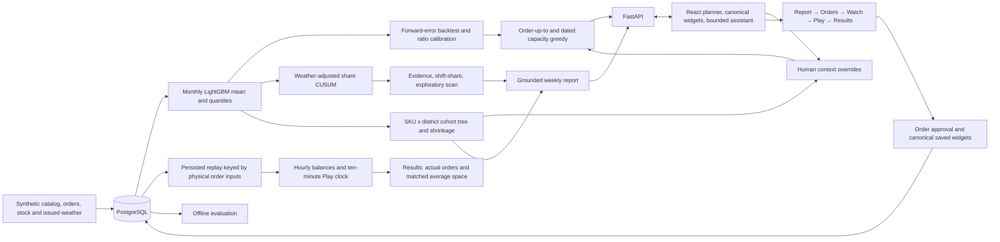

# Scoop: system design and technical document

**Corporate Link Challenge 2026 - working prototype**

| Project record | Value |
|---|---|
| Repository | [Hcrab/scoop-clc2026](https://github.com/Hcrab/scoop-clc2026) |
| Branch | `claude/scoop-prototype` |
| Data | Deterministic synthetic ice-cream distribution world; public demo seed 93, 27 July 2026 |
| Team | ID, roster and individual contributions to be confirmed by the team before submission |

This development document describes the implemented system and its measured results. Team identifiers and individual contribution declarations remain for the team to complete.

## 1. Problem and proposed solution

Cold storage is scarce. A warehouse planner has to replenish familiar products while distinguishing weather-driven demand from persistent changes in preference. A replenishment-request increase can also be a promotion, a single large order or a shift in the mix of stores. Treating each increase as permanent can tie up space; ignoring it can cause shortages.

Scoop connects a weekly evidence review to concrete case quantities. Cohort effects feed recommendations constrained by supplier calendars, case packs, stock, pipeline and warehouse capacity. The planner supplies optional context and reviews the resulting orders. An assistant explains evidence and makes explicitly requested, undoable changes. The five-screen flow carries the reviewed plan through monitoring, timed replay and measured results.

The default prototype represents one DC, 20 stores, four districts and 75 SKUs. All product, customer, order and weather records are synthetic. Its commercial hypotheses require validation on authorised operational data. Other seeds remain internal evaluation fixtures.

## 2. Architecture and data flow

The generation command creates relational source tables. Model runs use time-bounded features; reusable artifacts are cached locally and excluded from version control. Planning persists cohort effects/cards, early warnings and purchase suggestions. Overrides and dashboard layout are saved alongside decision receipts; the historical ORM table named WatchItem stores the canonical widgets. The report reads calculations and can explore evidence; its text does not directly control orders. Approval queues a replay that stores per-product series for both policies; its key uses effective physical inputs, so widget edits do not recompute it. The HTTP API returns typed JSON to the UI. Offline evaluation uses explicit training, calibration and replay intervals.

## 3. Data model

| Layer | Main entities | Purpose |
|---|---|---|
| Reference data | Store, Node, Supplier, Product, Nutrition, TagDimension, Tag, ProductTag | Locations, warehouse capacity, calendars, case packs and comparable attributes |
| Daily facts | StoreOrder, NodeInventory, WeatherDaily, WeatherForecast, Promotion, PurchaseOrder | Demand versus fulfilment, stock, information vintages and known commercial events |
| Analytical output | ModelRun, DailyExpectation, CusumSeries | Forecast lineage and signal evidence |
| Decision workflow | Plan, Finding, Hypothesis, Question, Decision, DirectionItem, PurchaseSuggestion, WatchItem, ChatMessage, SimulationRun | Human interpretation, recommendations, approvals, widgets and persisted replay |
| Evaluation only | GroundTruthEvent | Planted scenarios for scoring; not investigator inputs |

The generated world spans June 2024 to August 2026. Seed 93 has 75 SKUs and 1,233,000 store-SKU-day order rows. The public demo opens 27 July 2026 with plan `P20260727`; Settings can select another supported week. The visible demonstration clock is the authoritative as-of date. Reading future rows is permitted in the offline scorer and Play replay, never as future actual inputs to a current planning recommendation.

## 4. Algorithms and decision flow

The visible flow is **Report → Orders → Watch → Play → Results**. Completed steps remain revisitable. Cohort cards expose cases, expected value, pallet footprint and whole-warehouse peak; the right-side tree and evidence modal share a saved root-to-leaf drilldown whose selected row controls the daily curve. Optional context and the stock-versus-space service control recompute orders and produce Undo receipts. Orders are grouped and paginated, with CSV export and approval in that step. Approval queues one persisted replay. Canonical widgets have server-saved layout and continue through Play to their actual approved-order final states on Results. Play starts automatically at fixed 2×, advances a ten-minute clock at about two seconds per day, supports Pause/Resume/Replay and waits for explicit **See results** at the final frame. The discussion dock is optional.

### 4.1. Demand forecast

A Poisson-mean LightGBM model and 0.1/0.9 quantile models use catalog, calendar, promotion and issued-weather features. Monthly versions train through the preceding month; detection and purchasing use the same version. The Poisson mean supplies the central level displayed as p50; it is not a separately trained median quantile. This gives an ordinary-demand counterfactual and protection-period mean.

N5 adds temperature interactions for the catalog's three dairy bands and seven serving formats. Artifact identity `monthly-issued-v2` prevents reuse of models without these features. Training dates, rounds and other model parameters are unchanged.

Code: `backend/scoop/algorithms/forecast.py`, `backend/scoop/algorithms/runs.py`.

### 4.2. Rolling backtest and baselines

For a past issue date and SKU, `r = actual protection demand / max(forecast, 1)`. The next month's distribution uses the preceding model's genuinely forward ratios, clipped to `[0.3, 3]`. Evaluation also compares a 28-day moving average and same-weekday daily forecast, and a 28-day protection baseline. Forward transfer avoids calibration on a model's own training outcomes but assumes errors remain comparable.

Code: `backend/scoop/algorithms/forecast.py`, `backend/scoop/algorithms/runs.py`, `backend/scoop/evaluate.py`.

### 4.3. Weather-adjusted CUSUM

For attribute group and district, `z = (actual share - expected share - calibration bias) / calibration SD`, `S+ = max(0, S+ + z - 0.25)`, `S- = max(0, S- - z - 0.25)`. The expectation incorporates ordinary weather and promotions. Seven-day block bootstrap paths choose a threshold for approximate in-control `ARL0 = 90` days; bootstrap-tail p-values also pass Benjamini–Hochberg at `q = 0.10`. Correlation and repeated looks prevent an exact ARL/FDR guarantee.

Code: `backend/scoop/algorithms/cusum.py`, `backend/scoop/algorithms/runs.py`.

### 4.4. Shift-share explanation

With total requests `T` and group share `s`, `Δ(Ts) = (T1-T0)s0 + T0(s1-s0) + (T1-T0)(s1-s0)`. The volume, mix and interaction terms describe the change; they do not prove customers switched products.

Code: `backend/scoop/algorithms/shiftshare.py`, `backend/scoop/ai/investigator.py`.

### 4.5. Cohort tree

Each eligible SKU × district compares recent 14 days with the previous 56 eligible days: `y = log((Ar+.5)/(Er+.5)) - log((Ab+.5)/(Eb+.5))`. Variance adds count overdispersion `phi(1/(Ar+.5)+1/(Ab+.5))` and a measured forecast-error component. The latter estimates baseline weekly log residual variance beyond count sampling, clips it at zero, and scales it to the two averaging windows; it has no fixed percentage floor. These are current-model residuals with historical issued weather, so some baseline dates are in the model's training period. Promotion days are excluded; requests are capped per store/SKU at the eligible-history 99th percentile. Candidate splits come from existing catalog groups and districts, need at least three distinct SKUs on each side, and stop at depth three. The maximum inverse-variance gain is tested against 199 max-gain permutations at fixed `p < 0.05`.

The saved drilldown aggregates each actual path prefix and its sibling within the same parent. Bars display the inverse-variance weighted raw log-change transformed to percent, before shrinkage; the card's headline remains the shrunk leaf estimate. The daily curves use raw eligible requests and their current-model expectations.

Code: `backend/scoop/algorithms/cohort_model.py`.

The illustrative seed-93 world uses the specifically authorized `alpha = 0.10` exception. After the weather/variance/cost fixes, the 27 July tree stopped at root `p = 0.0502512563` under 0.05. At 0.10 its strawberry path tests were 0.0502512563, 0.0954773869 and 0.0050251256. Other worlds and the pure statistical fitting functions retain 0.05; permutation units, depth, minimum sizes and shrinkage are unchanged. This is a demo setting, not a new validation claim.

### 4.6. Corrected permutation units

A product-tag permutation moves an entire SKU's district `y,v` vector among SKUs with the same district support. A district candidate permutes districts within each SKU. Both values move together. This better preserves correlated forecast error than shuffling individual rows; exchangeability remains an assumption.

Code: `backend/scoop/algorithms/cohort_model.py`.

### 4.7. Empirical Bayes and partial alignment

DerSimonian–Laird between-leaf variance `tau_b` yields leaf data weight `tau_b/(tau_b+V)` and posterior mean `weight × raw`. Within-leaf effects shrink toward the leaf. SKU log effects weight districts by recent expected demand; variance retains shared-leaf covariance along with individual conditional variance. `f50 = exp(m)` and `f10/f90 = exp(m ± 1.2816 sqrt(s2))`. Current-model rescoring of 70-day history retains historical issued weather and can absorb an older change after retraining.

Code: `backend/scoop/algorithms/cohort_model.py`.

### 4.8. Override priors and controls

`one_off` zeroes selected log effects; `ends_on` uses `1 + fraction × (exp(m)-1)` over arrival-to-review dates; `cap` truncates the log effect at `log(1+pct)`; `expect` uses a shared normal cohort prior with SD 0.30/0.15/0.07 for low/medium/high strength. A direct `cases` override edits a SKU order. Saved tag-path membership and optional districts define scope independently of changing leaf IDs.

Code: `backend/scoop/algorithms/cohort_overrides.py`, `backend/scoop/cohort_context.py`.

### 4.9. Order-up-to and critical ratio

Calendar-aware protection includes wait until supplier order day, lead time and review. For the default margin objective, shortage cost `Cu = price-cost`; excess cost `Co = 0.025 × cost` per ordering cycle (1% storage/financing plus 1.5% summer carryover/markdown); `CR = clip(Cu/(Cu+Co), 0.5, 0.98)`. This illustrative summer cost assumption replaces the earlier 25% cost input and also drives marginal capacity allocation. An explicit service parameter replaces that ratio with the same clipping bounds. The CR demand quantile gives target `S`; buy `ceil(max(0, S-on_hand-on_order)/units_per_case)` with MOQ when positive. Empirical demand ratios mix with lognormal factor error by deterministic quadrature and are re-centred at the empirical median.

Code: `backend/scoop/algorithms/forecast.py`, `backend/scoop/algorithms/replenish.py`, `backend/scoop/planning.py`.

### 4.10. Arrival-dated capacity greedy

Occupancy is projected on each arrival date with each SKU's own units per pallet. While added orders exceed `max(physical capacity, inherited no-new-order occupancy)` on any date, remove the eligible last case with the lowest approximate marginal value per pallet, or an MOQ block. Inherited POs can still leave the store above physical capacity; this is not a global optimum.

Code: `backend/scoop/algorithms/replenish.py`, `backend/scoop/planning.py`.

### 4.11. Canonical widgets

Server validates `{title, scope, metric, threshold}`. Scope is warehouse/cohort/tag/brand/SKU; metric is on-hand, lost units, demand, fill rate, days cover, pallets, or requested versus expected. Historical requested/shipped/stock and saved expectations feed persisted, reorderable charts and source tables; edits are undoable. Watch saves the canonical widget definitions. Play aggregates its stored per-SKU series into those same widgets, and Results shows their final values from the actual approved-order replay.

Code: `backend/scoop/dashboard.py`, `backend/scoop/api/dashboard.py`, `frontend/src/Dashboard.tsx`.

### 4.12. Two-policy Play

Both sides begin with the same closing stock, historical POs in transit and future synthetic requests. Scoop week one uses saved cases or post-cut suggestions; later weeks refit cohorts and order automatically. The rule orders toward `1.25 × mean(last 28 days) × (lead+review)`, then rounds to cases/MOQ. New orders arrive after lead time. Daily shipped units are `min(on_hand, requests)` and lost units are unmet requests. Charts use the latest saved expectation issued before the plan. Later automatic orders call the ordinary as-of-day forecast and cohort path, including the monthly version change when reached. Approval prepares and persists both policies' per-product replay data under the effective-order-input key. The replay's hourly demand, dispatch, shortage and receipts reconcile with each daily row; inventory is a level whose hourly changes reconcile with opening and closing stock. The ten-minute playback clock uses those saved flows, with hourly chart redraws and timestamped events.

Code: `backend/scoop/play.py`, `frontend/src/Play.tsx`.

The replay horizon is the longest positive ordered supplier lead plus seven days, at least seven days and capped at 21 days and the available generated calendar. The default 27 July replay spans 16 days.

N5 prepares a separate matched-average-space comparison in the same background job. The actual approved-order replay counts as one evaluation; at most five more evaluations test explicit service levels from 0.50 to 0.98, then bisect when needed. A service candidate within the 2% space tolerance stops further search. Selection minimizes measured average-pallet difference from the unchanged rule, never the shortage result. If the tolerance cannot be reached, Results labels the closest measured comparison. All policies share opening stock, in-transit receipts, requests and weather information; planner quantity deltas and absolute case overrides remain attached to the candidate plan. The actual approved-order replay and final widgets remain available separately.

The read-only exploratory scanner separately tests one-to-three-tag intersections across district scopes with a seven-lag Bartlett–Newey–West variance and Benjamini–Yekutieli adjustment. It is an approximate screen, not a cohort tree split or a newly calibrated CUSUM discovery (`backend/scoop/algorithms/trend_scan.py`).

The AI report uses bounded read-only tools, cited evidence IDs, numeric-claim checks, one repair attempt and an offline fallback (`backend/scoop/ai/weekly.py`, `backend/scoop/ai/grounding.py`). The model authors constrained prose and HTML/CSS; host code renders data charts from saved series, not model-authored SVG (`backend/scoop/ai/report_design.py`, `frontend/src/reportCharts.ts`). The default P6 report received a disclosed human editorial correction after the real Gemini generation. Chat uses `gemini-3.8-flash` when configured, validated tool calls and a deterministic fallback (`backend/scoop/ai/gemini.py`, `backend/scoop/ai/chat.py`).

## 5. Setup, test and demonstration

See `README.md` for the exact installation and run commands and `docs/DEMO.md` for a guided demonstration. Reproducibility requires PostgreSQL, the pinned Python environment, and the frontend lockfile. Synthetic loading replaces tables in the configured database and is a first-run/reset operation, not a normal startup step.

The demo supports weekly plans from June through August 2026. On the default 27 July plan, inspect the report and strawberry path, optionally add context, review and export grouped orders, approve them, add a Watch widget, play the prepared result and explicitly open Results. Completed steps can be revisited; discussion questions do not block progression. Reload to verify saved state. Stores and Catalog provide source context.

## 6. Validation and limitations

The evaluation includes forecast errors against simple baselines, planted-event detection delay, null-world alert behaviour, explanation labels and an inventory replay. Results are generated in `reports/`, with the precise interpretation in `docs/ALGORITHM_NOTES.md`. Missing detections and unfavourable service/inventory trade-offs remain in the report.

The no-trend counterfactual keeps the same catalog, weather and known promotions while removing preference drift, exceptional promotion uplift and bulk orders. It is reproducible for a seed, but changed Poisson intensities mean draws do not remain exactly paired after the first change; it is a detector diagnostic, not a causal estimator.

The earlier seed-42 algorithm evaluation reports these outcomes; it is not the seed-93 default Play:

| Measure | Scoop | Comparison / context |
|---|---|---|
| Daily demand WAPE, April-May | 49.48% | 28-day average: 52.50%; same weekday: 70.72% |
| Rolling protection WAPE, April-August | 10.85% | 28-day average: 10.04% |
| Protection interval coverage | 64.49% | 780 forward windows; nominal 80% |
| BH-gated missed targets | 1 of 11 | 1/7 strong and 0/4 weak; 9 detections more than 14 days late |
| Null-world alarm episodes | 0 after BH gate | 547 raw episodes; one synthetic diagnostic |
| Full policy at 96% protection quantile | 98.58% fill; 29.0 average pallets | Historical x1.25: 98.72% fill; 32.0 pallets |
| Fixed reorder-point baseline | 79.06% fill; 16.0 average pallets | Frozen May mean; no adaptation to later demand |

The full policy uses less average inventory but provides slightly lower service than the historical x1.25 policy; its pre-shipment peak is also higher (58.2 versus 57.4 pallets). This is a trade-off, not a universal win. Forecast aggregation performs worse than the moving-average protection baseline, and interval undercoverage is material, especially in July. Investigator labels agree with 8 of 12 matched findings; four unmatched findings are retained. Exploratory weak candidates have 18 confirmations in 36 complete followups, with eight right-censored candidates; the different-scope random comparator is not a formal superiority test.

A prior seed-42 Gemini walkthrough explained a Water-based finding and calculated a read-only 35°C scenario. Its quantities depended on that older plan state. Provider answers still require human review; successful tool validation does not prove every generated sentence is correct.

At Night 1 P6 acceptance, the backend suite passed 231 tests, the TypeScript/Vite production build passed, and the seed-93 default browser demo passed. P7 then repeated installation, fresh data load, uncached monthly model training and frontend build from a clean clone against a new database. With provider configured as Gemini and the key empty, actual ASGI startup, the card-list report, a scripted widget change, exact Undo and Orders progression passed with zero provider calls. A separate Edge test passed in 21.2 seconds over the real ASGI/stdio transport (`reports/p7-clean-runtime.txt`, `reports/p7-empty-key-smoke.json`, `reports/p7-empty-key-browser.json`). These are historical setup checks. The central acceptance ledger is `docs/overnight-report.md`.

Night 2's final backend suite passes 260 tests. The N6 Edge walkthrough exercises the real five-screen flow, adds a widget without a simulation request, reaches measured Results and restores exact orders and widget layout. A separate TCP server with an explicitly empty Gemini key serves the native card-list report and Orders view; that browser test passes with no page errors and unchanged quantities. The provider ledger remains at 152 calls through these N6 checks (`reports/n6-walkthrough.json`, `reports/n6-empty-key.json`, `reports/n6-usage.json`).

Application validation covers phase guards, persisted choices, invalid input, idempotent confirmations and as-of views. Frontend compilation and a browser walkthrough provide separate evidence of the usable interaction. A successful build alone is not treated as proof that every flow works.

The P6 seed-93 default Play covers 20 July–4 August (16 days), with no active context overrides. The physical capacity is 71 pallets. The synthetic history rule peaks at 65.4033 pallets over this selected window, or 92.12% of capacity. Full generated July–August history has a separate 77.8620-pallet peak, above that capacity; it is not the selected Play window. The default Play loses 11,528 units with Scoop versus 10,191 with the rule, while averaging 36.6402 versus 44.6169 pallets. A 27 July seven-day rerun loses 1,344 units on each side and averages 53.8392 versus 55.2196 pallets. These are observed trade-offs, not a universal savings claim (`reports/p6-play-final.json`, `reports/p6-capacity-correction.json`).

In the archived Night 1 world, the default first cohort card was the broad 25-SKU Water-based leaf. Its 27 July planted-group check gave the strawberry split `p = 0.1005025126`, above the then-fixed 0.05 criterion; across two null seeds and 34 weeks there were 4 root splits against a limit of at most 3. Those historical P1 criteria remain blocked in the Night 1 report. N5 changes the illustrative world and makes only the newly authorized fixes described above; the archived null results do not validate the revised world (`reports/cohort-seed93-block-evaluation.json`, `reports/cohort-null-block-evaluation.json`).

The revised illustrative seed-93 default is 27 July. Strawberry × water-based × value-price requests ramp 6–20 July to +50%; Mango × Kowloon ramps to +35%; coating declines 20–27 July to −20%. A 33.4–33.8°C heat period runs 31 July–8 August. The exact four-product strawberry leaf (IC006/061/062/063) is the first card, estimated at +38.1552% (80% interval +35.1210% to +41.2575%). Its saved root-to-leaf path reads +11.2/+23.6/+39.2% against same-parent remainders −0.8/−0.4/+0.2%. Mango × Kowloon has no separate card: the remaining non-strawberry/non-coated branch's best Low sugar split stopped at `p = 0.371859`. The quiet 22 June week has no cards. Capacity is 60 pallets; the unchanged rule peaks at 57.986597 (96.64%). At matched average space (36.578548 versus 36.609444 pallets, a 0.084394% gap), this plan has 11,160 versus 11,564 short units, but 89 versus 75 stockout product-days and HK$68,203.72 versus HK$61,438.78 lost margin. Three evaluations selected the actual policy. Even the explicit 0.98 service bound gives 86 versus 75 product-days and HK$61,842.60 versus HK$61,438.78 lost margin. The all-three-metrics superiority criterion remains blocked under the no-further-tuning exception; it is not presented as a policy win. See `docs/overnight-report.md` and `reports/n5-replay-analysis.json`.

### Simplifications

| Choice | Practical consequence |
|---|---|
| Synthetic demand, weather, catalog and POs | Reproducible mechanics do not establish sponsor demand or commercial impact. |
| Only existing tag/district splits, at least three SKUs per child, depth three | The production tree is conditional and constrained, not an exhaustive search of all intersections. |
| SKU observation → tree → shrinkage → forecast factor → cases | A visible signal does not bypass inventory, supplier calendar, MOQ, uncertainty or capacity. |
| Preceding-month forward errors transferred to a new model | Avoids scoring on training outcomes but can under-cover if forecast errors change across months. |
| Empirical ratios mixed with lognormal factor error | The distribution is an approximation; forecast error correlations are not fully modelled. |
| Dated greedy capacity removal | Results need not be globally optimal; inherited arrivals may already exceed physical capacity. |
| Exogenous requests and shared DC stock in Play | Both sides face the same requests; there is no district stock ledger or stock-to-demand feedback. |
| Fixed intraday timing | Intraday timing comes from a fixed demand curve and delivery windows; daily totals equal the daily simulation. Requests peak in the afternoon, supplier receipts land in the morning, supplier orders use a 14:00 cut-off and dispatch runs from 18:00 to 22:00. |
| Illustrative compound scenario | Seed 93 is a deliberately designed example, not a multi-seed evaluation or evidence of general superiority. The planted answer key is private to offline checks. |
| Matched average space | Up to six measured replays adjust only the compared plan's service level; the selected result minimizes average-pallet distance within a 2% tolerance. Cases and a finite horizon make exact matching discrete. Actual approved-order results remain separate. |
| Hourly inventory balances | Demand, dispatch, lost units and receipt flows reconcile to their daily totals. On-hand stock is a level: hourly changes reconcile to closing minus opening, and each hourly balance reconciles receipts and dispatch. |
| Cohort level projection | The latest effect is held over the planning window, without trend extrapolation. |

### Limitations

Monthly reset can delay detection. CUSUM's ARL and BH gate are approximate under correlated attributes and repeated daily testing. The SKU-block and within-SKU permutations retain relevant error structure but still depend on exchangeability that has not been established for all real forecast errors. The older rolling protection forecast WAPE (10.85%) trails its 28-day average baseline (10.04%), and nominal 80% intervals covered only 64.49% of 780 forward windows; correlation and transferred calibration remain material concerns (`docs/ALGORITHM_NOTES.md`).

An `expect` override is a planner prior, not new observed sales. The cap uses exact marginal truncated-normal moments but omits cross-district covariance after nonlinear truncation. Sparse or interrupted source rows are excluded from the cohort fit. The Night 1 default AI report needed a human editorial pass; the current N5 report was generated without manually rewriting its prose. Numeric grounding cannot guarantee correct causal prose. Synthetic order confirmation does not rewrite historical warehouse stock. No real supplier integration, deployment authentication, tenancy or production operations are included.

## 7. AI, data and third-party disclosure

Product illustrations were generated with ChatGPT image generation (OpenAI). Each of the 75 catalog illustrations was generated in its own request using one common style reference, resized to 256 pixels and stored locally as a WebP under 30 KB. The tag-composed SVG remains underneath as the fallback. The per-product prompts and asset checksums are recorded in `reports/n4-image-generation.json`.

Claude materially contributed the original product discussion, architecture, synthetic data generator and analytical implementation. OpenAI Codex recovered the interrupted work, completed the local application and assisted with review, corrections, verification and documentation. Human team members must review the implementation and supply their own accurate contribution statements. A tool-generated document cannot attest to human contributions.

The runtime data is generated by `scoop.synth.generate`; no sponsor transaction dataset is included. Product names and tags are fixtures. See `docs/THIRD_PARTY.md` for dependencies and installed licence metadata. No external weather API is used. The repository default uses the offline assistant; the delivered local session is configured for the explicitly requested Gemini trial, transmitting synthetic plan context only.

## 8. Team and submission readiness

The team can add its confirmed Team ID, name, roster and specific member contributions when preparing its submission. This delivery consists of the implementation branch, application and documentation; it does not submit material to the organisers.
